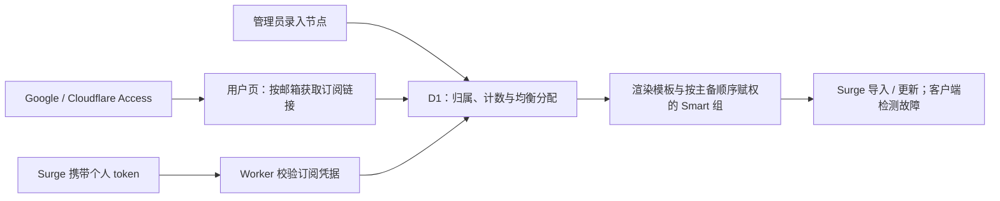

# AtlasRouter

AtlasRouter 是基于 Cloudflare Workers 的多用户 Surge 配置订阅系统，集中维护分流规则、模块和节点池。

用户通过 Cloudflare Access + Google 登录，以验证后的邮箱识别账号，在个人页面获取专属订阅链接。管理员录入节点后，系统按地区/IP 类型分组，为每个用户分配各组主节点，并生成均衡轮转的备份顺序。节点不足时允许共享主节点。

用户、节点与分配关系分别保存在 Cloudflare D1 SQLite 的 `users`、`nodes`、`assignments` 表中；不保存 JSON 快照，也不再提供旧版手动订阅或兼容入口。节点信息、订阅凭据不写入仓库。

## 当前状态

首版已实现登录、自动分配、订阅生成；支持 Cloudflare Workers Builds 按 Git 分支部署，GitHub Actions 只运行验证：

- `README.md`：项目说明与维护入口。
- `AGENTS.md`：面向后续 LLM/Agent 协作者的仓库工作规范。
- `docs/`：设计、部署、运维和决策记录。
- `worker/`：Cloudflare Worker 订阅服务。
- `speedtest-worker/`：独立部署的静态测速外观站，根路径展示界面演示，见 [使用说明](speedtest-worker/README.md)。
- `surge/`：Surge 主配置模板。
- `modules/`：Surge 模块。
- `references/`：历史配置和样例，仅用于理解已有想法，不作为事实来源或实现依据。

## 目标组成

后续实现可以按下面的职责拆分，具体目录以实际代码为准：

- `worker/`：Cloudflare Worker 订阅入口、鉴权、节点注入、配置渲染。
- `surge/`：Surge 主配置模板、策略组定义和规则配置。
- `modules/`：Surge `.sgmodule` 模块。
- `scripts/`：Surge 脚本与相关说明。
- `docs/`：架构说明、部署流程、配置约定和变更决策。
- `references/`：非权威参考材料，避免被生产逻辑直接依赖。

## 订阅生成流程



## 维护原则

1. 节点、Token、上游订阅链接等敏感信息不提交到 Git。
2. `references/` 中的内容只能帮助理解方向；实现前以仓库代码、当前需求和官方文档为准。
3. Surge 规则保持可解释的顺序：越具体的规则越靠前，兜底规则放最后。
4. Worker 中的订阅鉴权、路径分发和错误响应要保持简单明确。
5. 新增规则、策略组或模块时，同步更新说明，避免配置和文档漂移。

## 本地验证

```sh
cd worker
npm ci
npm test
```

使用 Node.js 24。`npm test` 包括单元测试、部署构建检查和 Miniflare/workerd 集成测试，覆盖本地 D1 的并发分配与重启持久化。测试、构建和部署前会将 `surge/` 和 `modules/` 中的静态资产打包进 Worker。

统一网页入口为域名根路径 `/`，订阅链接为 `/AtlasRouter?token=<token>`。普通用户看到个人订阅，管理员在同一页还可管理节点池和用户；角色由验证后的邮箱及 `ADMIN_EMAILS` 决定。个人 API 位于 `/api/account/*`，管理 API 位于 `/api/<slug>/pool/*`；随机标识由 `ADMIN_API_SLUG` Secret 提供，每次 `npm run deploy` 自动生成并随代码发布，仅注入管理员页面；部署后需刷新已打开的管理员页面。`/admin`、`/api/admin/*` 和旧订阅等入口均已停用，到达 Worker 后返回 404。完整部署步骤见 [Cloudflare 部署](docs/deployment-cloudflare.md)，分配规则见 [多用户与节点池](docs/multi-user.md)。

页面可选启用 DoH 和 Client（默认 Surge / Clash），分别通过 `doh=1`、`client=clash` 注入订阅链接。Clash / Mihomo 输出由同一份完整 Surge 配置转换，自动跳过不兼容内容，不需要维护两份分流配置。参数与兼容范围见 [订阅说明](docs/subscription.md)。

线上安全探测需要手动执行，不属于默认测试：

```sh
cd worker
npm run check:live-security -- https://<worker-domain>
```

也可以把目标域名放在本地 `worker/.env` 的 `ATLAS_ROUTER_BASE_URL` 中，然后直接运行 `npm run check:live-security`。检查随机管理 API 还需在环境中提供 `ADMIN_API_SLUG`，否则脚本明确跳过该部分；输出会遮蔽随机路径。`.env*` 已被 git 忽略，不应入库。

完整安全测试流程见 `docs/security-pentest.md`。

## 统一部署

Cloudflare Workers Builds 直接连接 GitHub 并监听推送：`atlas-router-dev` 监听 `develop`，使用独立 D1；`atlas-router` 监听 `master`，使用生产 D1。每个 Worker 在 Cloudflare 构建中验证后，通过各自的命令部署。GitHub Actions 只检查代码，不持有部署凭据，也不触发部署；无需配置 GitHub Environment Secrets。两端分别设置 Access、管理员 Secrets 和节点，连接步骤见 [部署说明](docs/deployment-cloudflare.md)。

开发环境的本地部署命令为 `npm --prefix worker run deploy:dev`，使用 `worker/wrangler.dev.jsonc`；构建检查使用 `npm --prefix worker run build:dev`。

本地手动部署时，在仓库根目录运行以下命令，会依次部署 `atlas-router` 订阅服务和 `pulse-speedtest` 测速站：

```sh
npm --prefix worker run deploy
```

加上 `-- --dry-run` 可检查两个 Worker，不执行远程迁移或发布。只更新其中一个时，使用 `npm --prefix worker run deploy:router` 或 `npm --prefix worker run deploy:speedtest`。Cloudflare Builds 必须使用单个 Worker 的命令；脚本在远程操作前校验监听分支和目标 Worker。订阅服务仍会先执行 D1 迁移并轮换管理路径 Secret；只更新测速站不会触发这些操作。两项本地发布并非原子操作，后一步失败不会回滚已经成功的前一步。详情见 [Cloudflare 部署](docs/deployment-cloudflare.md)。

## Cloudflare Worker 配置约定

实际变量名由 Worker 实现决定，但应遵守以下边界：

- 通过 `DB` binding 使用 D1，节点池使用 `users`、`nodes`、`assignments` 表，分配更新通过版本检查和多表事务提交。D1 读取权限视为敏感配置读取权限；不再需要 KV 或 Durable Object binding。
- 网页及 API 由同一个 Cloudflare Access + Google 应用保护，Worker 校验 JWT；管理操作还校验管理员邮箱白名单。
- `ADMIN_EMAILS`、`ADMIN_API_SLUG` 使用 Worker Secret；Google OAuth 客户端密钥配置在 Cloudflare Access 身份提供商中。
- 本地开发时不要提交 `.dev.vars*`、`.env*` 或任何真实节点信息。
- Worker 代码应从 `fetch(request, env, ctx)` 的 `env` 参数读取绑定，避免硬编码。

## Surge 配置约定

- 自动订阅的 `[Proxy Group]` 使用 `surge/pool-groups.conf`，动态生成如 `🇺🇸USA-ISP`、`🇭🇰HK-IDC`、`🇸🇬SG-WARP` 的 `smart` 组，按个人主备顺序生成 `1、2、3…` 的 `policy-priority` 评分系数；开发环境试验 `1、3、9…`，Clash 均转换为同顺序的 `fallback`。
- `[Rule]` 负责流量匹配，规则按文件顺序从上到下匹配，并以 `FINAL` 规则兜底。
- 外部策略可通过 `policy-path` 引入，区域筛选可用 `policy-regex-filter`。
- 模块文件用于对主配置做局部覆盖或追加，不应承担主配置无法解释的大段逻辑。

## 官方文档

- [Surge Manual](https://manual.nssurge.com)
- [Cloudflare Workers Docs](https://developers.cloudflare.com/workers)
